# 知识库方案：开源最佳实践

面向检索增强（RAG）的知识库内核设计。本文只谈开源社区已被验证的做法与取舍，不绑定具体项目。

---

## 零、先判断要不要建知识库

这一步被跳过的次数远超想象。知识库是基础设施，不是默认选项。

**语料小于 ~200K token（约 500 页）时不要做 RAG。** 直接把全部内容放进提示词，配合提示缓存，效果更好、链路更短、没有检索失败这一类故障。这是 Anthropic 在 Contextual Retrieval 一文里给出的明确边界。

长上下文模型并没有取代 RAG，两者解决的是不同问题：

| 维度 | 长上下文 | 检索 |
|---|---|---|
| 擅长 | 全局综述、跨章节推理 | 定点查找、精确引用 |
| 规模 | 受窗口与成本限制 | 任意规模 |
| 新鲜度 | 取决于请求时塞了什么 | 索引更新即生效 |
| 权限 | 难以按用户隔离 | 可按租户/角色过滤 |
| 成本 | 注意力二次增长 | 检索成本近似常数 |

生产系统里两者是组合关系：**检索把大语料收窄到一个子集，长上下文模型在这个子集上推理**。另一个常被忽略的事实是，有效召回并不随窗口线性增长 —— 窗口开大不等于模型真的用上了中间那段。

真正让 RAG 不可替代的只有三条：**规模**、**新鲜度**、**权限与可引用性**。如果一条都不占，先别建。

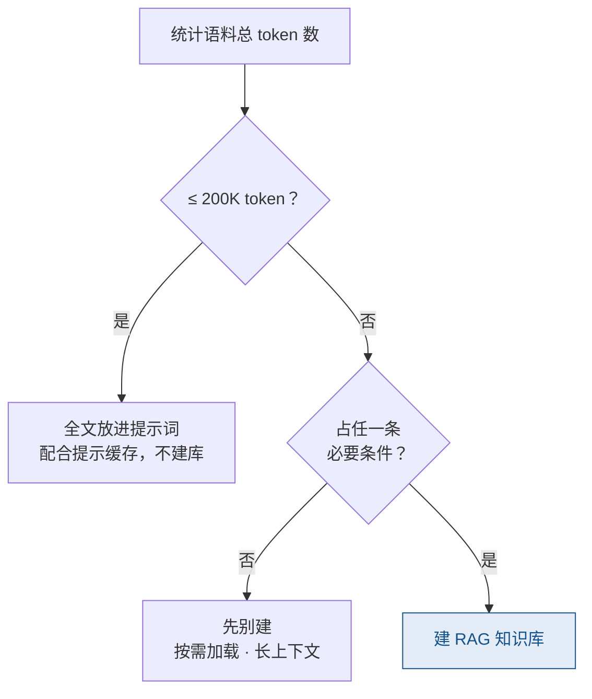

**图 1**　两道判断：先量总 token 数，200K 以内直接全文入提示词；超过了也要至少占一条必要条件，才值得多维护一条会失败的链路。

---

## 一、流水线的标准形态

成熟方案收敛到的形状基本一致，分摄入与检索两条链路。

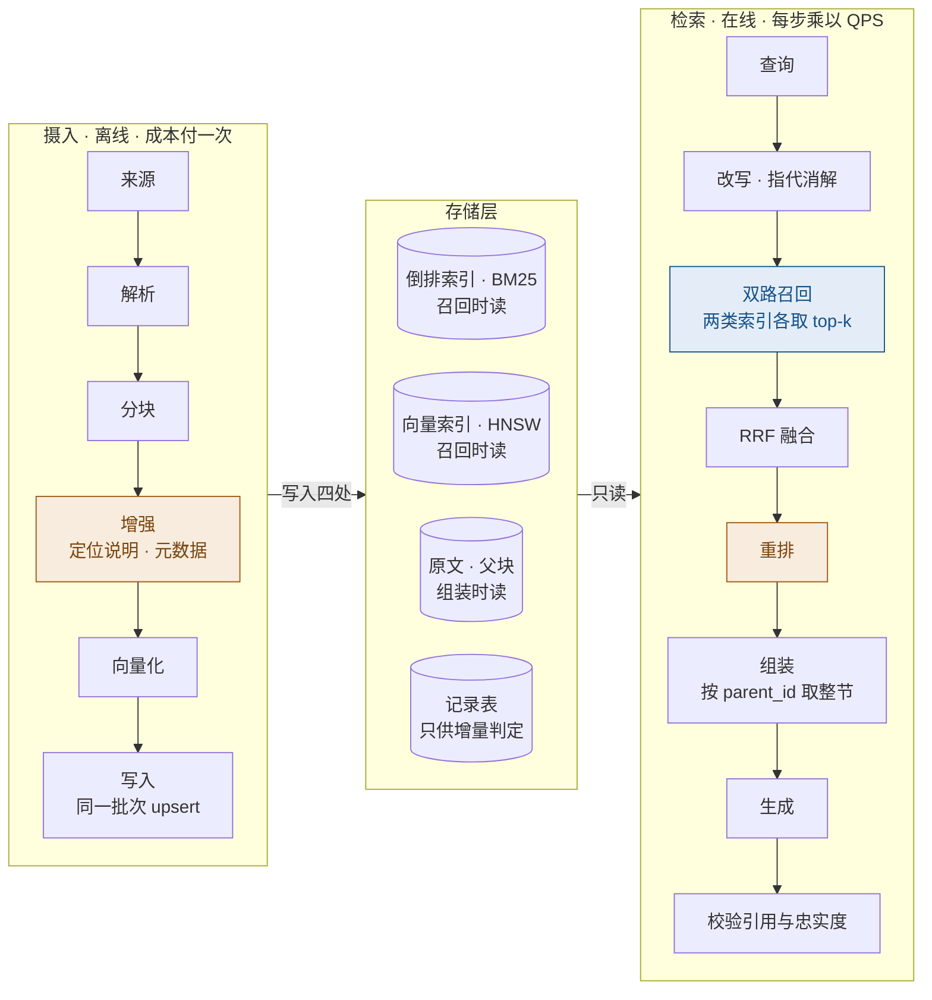

**图 2**　两条链路只在存储层相遇：摄入把同一批产物写进四处存储，检索从两类索引各取 top-k，组装时再按 `parent_id` 回到原文。左列的成本付一次，右列每一步都乘以 QPS。

两个容易做错的结构性判断：

**第一，尽量把计算挪到摄入期。** 摄入是离线的、可重放的、一次成本摊给所有查询；查询期的每一步都要乘以 QPS。上下文增强、结构抽取、元数据归一化、同义词扩展，全部属于摄入期。查询期只留下必须依赖查询内容才能做的事。

**第二，摄入链路必须可重放。** 分块策略要改、embedding 模型要换、解析器要升级，这些都会发生，而且会反复发生。把原始文档与派生产物分离存储，派生层随时可以整体重建 —— 否则换一次模型就是一次数据迁移事故。

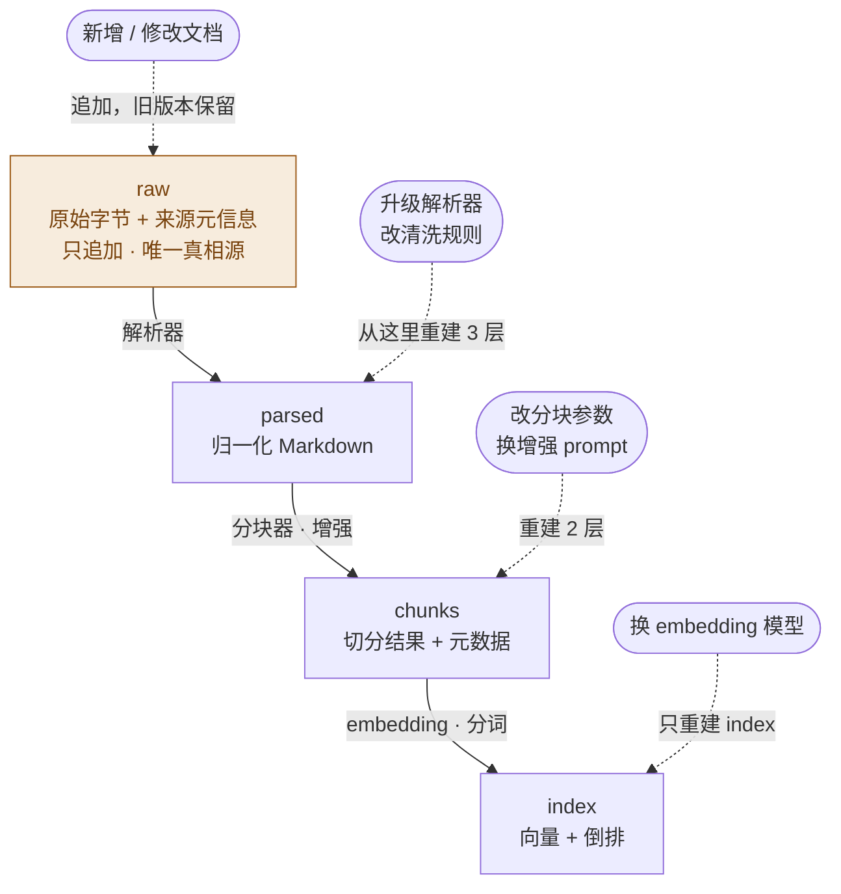

**图 3**　每类变更都有固定的重建起点，越上游的改动波及的层越多；`raw` 只追加、从不重建，任何一次重建都不需要回源重新抓取。

---

## 二、摄入侧

### 1. 解析：先把输入弄干净

**所有分块策略在脏输入上都会退化。** 导航栏、Cookie 横幅、页眉页脚、断裂的表格标记，这些噪声会同时污染向量与倒排索引，后面任何调优都补不回来。解析质量是整条链路的上限。

开源解析器的分工：

| 工具 | 定位 | 取舍 |
|---|---|---|
| **Docling** | IBM 开源、现属 LF AI & Data，MIT | 纯 CPU 约 1.5 页/秒，工程化最好，难扫描件不如 VLM |
| **MinerU** | OpenDataLab，VLM 后端 | 中文、科技与金融文档强，资源消耗高 |
| **Unstructured** | 格式覆盖最广，30+ 种 | 通用性换来单类文档上的精度妥协 |
| **Marker** | 基于 Surya OCR | 学术 PDF 场景针对性强 |

选型原则：**先确定语料的主要形态，再选解析器**，不要找"全能"方案。统一输出 Markdown，保留标题层级 —— 标题层级是后续结构分块和元数据的唯一可靠来源。

### 2. 分块：结构优先，不要迷信语义分块

这里有一个反直觉但证据明确的结论：**语义分块（semantic chunking）并没有稳定地赢过固定/递归分块**。Vectara 在 NAACL 2025 的研究里，固定大小分块在文档检索、证据检索、答案生成三项上都优于语义分块，额外的计算开销不被收益证明。多数独立评测也没能让语义分块在所有数据集上胜出。

实践上的默认选择：

- **结构感知的递归分块**：优先按标题、段落、列表、代码块边界切，切不动再退回字符级
- **大小 300–800 token**，重叠 10–20%
- 保留**标题路径**（`文档 > 章 > 节`）作为元数据，而不是只留正文

更关键的一个认知：**chunk 是检索单元，不是生成单元**。检索命中一个小 chunk，喂给模型的应该是围绕它扩展出的上下文（相邻块、整节、整个父文档）。把这两件事分开，就能用小 chunk 拿检索精度，同时不牺牲生成所需的完整性。这个模式在各框架里叫法不同（small-to-big、parent document retriever、auto-merging），机制是同一个。

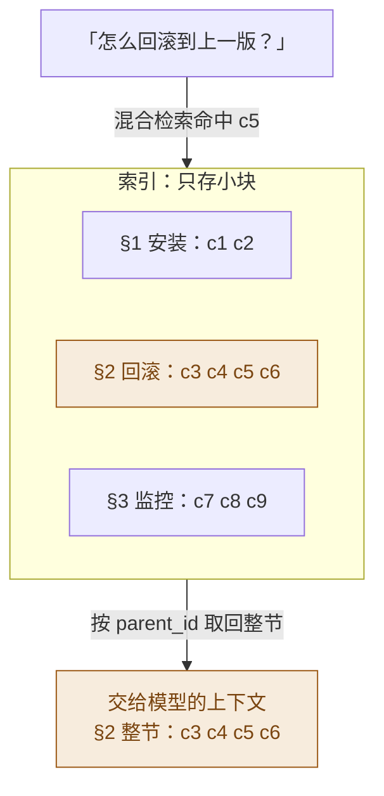

**图 4**　小块负责被找到，整节负责被读懂：命中 c5 后按 `parent_id` 取回整节 §2 交给模型，c5 仍在上下文里，只是不再孤立。

### 3. 上下文增强：当前性价比最高的一招

独立 chunk 丢失上下文是检索失败的主因 —— "营收增长了 3%" 这样的片段，脱离文档就无法判断说的是谁、哪一年。

**Contextual Retrieval** 的做法是在索引前，用 LLM 为每个 chunk 生成 50–100 token 的定位说明，拼在 chunk 前面，**同时用于 embedding 和 BM25 索引**。

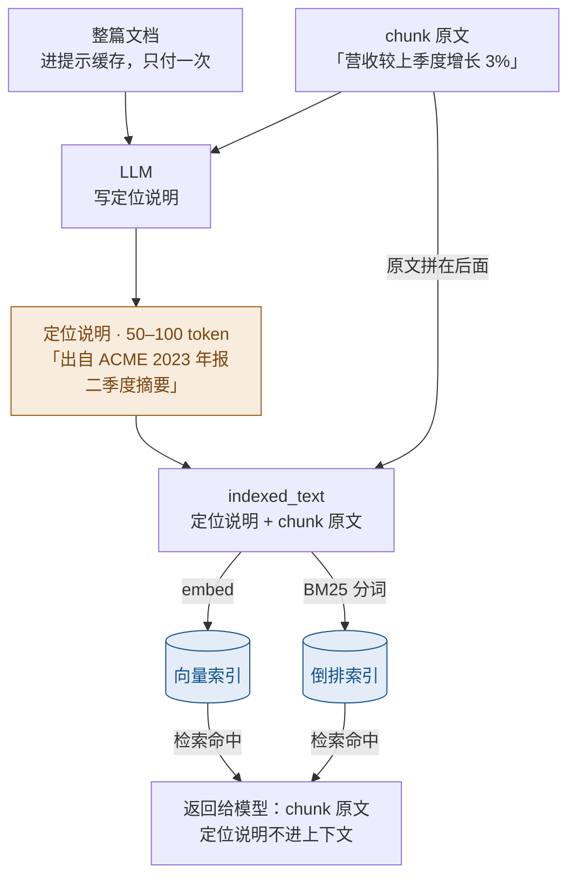

**图 5**　定位说明只进索引、不进上下文：向量与 BM25 索引的是拼接后的文本，检索命中后交给模型的仍是原文。

Anthropic 公布的效果（top-20 检索失败率，基线 5.7%）：

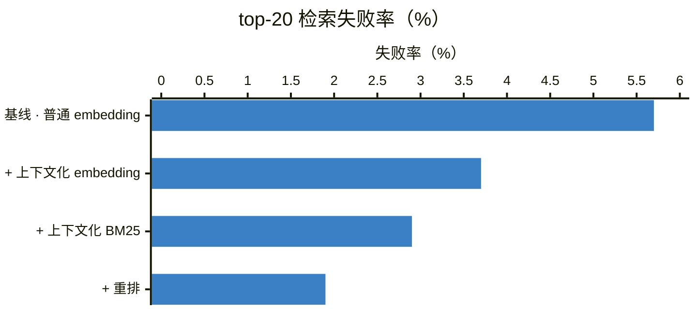

**图 6**　三项叠加，失败率从 5.7% 降到 1.9%。

| 配置 | 失败率 | 相对下降 |
|---|---|---|
| 仅上下文化 embedding | 3.7% | 35% |
| + 上下文化 BM25 | 2.9% | 49% |
| + 重排 | 1.9% | 67% |

成本是一次性的：**每百万文档 token 约 $1.02**，前提是用提示缓存把整篇文档缓存一次、而不是为每个 chunk 重发。

替代路线是 **late chunking**：先对整篇文档做 token 级 embedding，再按边界池化出各 chunk 的向量。它不需要 LLM 调用，成本低得多，但要求 embedding 模型支持长上下文，且只改善向量路，不改善词法路。两条路线目前没有在同一流水线里的严格对比，**语料里代词和跨章节指代多就选 contextual retrieval，成本敏感且文档较短就选 late chunking**。

### 4. 元数据：决定了这个知识库能不能上生产

每个 chunk 至少要带：

| 字段 | 作用 |
|---|---|
| `source` | 可引用、可溯源 |
| `section_path` | 结构定位、上下文扩展 |
| `updated_at` | 新鲜度过滤与排序 |
| `tenant` / `acl` | 多租户与权限隔离 |
| `content_hash` | 增量更新的唯一依据 |

权限字段尤其不能后补。**过滤必须发生在检索内部，不能是检索后在应用层筛** —— 后筛会让 top-k 被无权访问的内容占满，表现为"有权限的用户搜不到东西"。

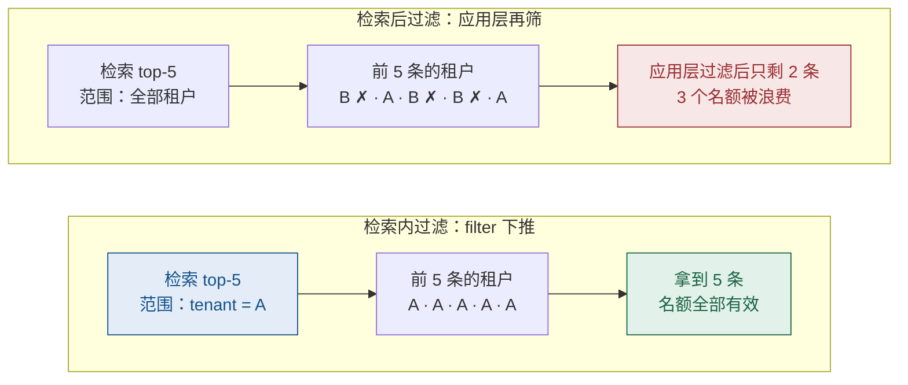

**图 7**　用户属于租户 A：后置过滤先在全部租户里取前 5 条，再丢掉 3 条无权内容；前置过滤只在可见范围里取前 5 条。测试账号通常有全量权限，所以上面那条路在测试环境里永远看起来正常。

### 5. embedding 选型

开源权重的两个主要选择：

- **Qwen3-Embedding**：当前开源权重第一梯队，Apache 2.0，32K 上下文，支持 Matryoshka 维度裁剪（32–7168），可按成本需要降维
- **BGE-M3**：MIT，100+ 语言，一个模型同时给出 dense / sparse / multi-vector，自托管多语言场景的常规选择

注意许可：Jina 的部分 embedding 与 reranker 权重是 CC-BY-NC-4.0，**商用需走托管 API 或单独授权**。选型前先看许可证，这是最容易在上线前才发现的坑。

一个常见错误：**对原始源码或原始片段做 embedding**。应当 embed 的是"意图 + 上下文摘要"。实现细节会淹没意图 —— 两段意图完全不同但写法相似的内容会被判为高相似度。

---

## 三、存储与索引

### 1. 向量库：按"引入最少基础设施"选

有一项同机、同数据集（118 万向量）、同 HNSW 参数的对比显示：在相同召回率下，不同向量库之间约有 **2 倍查询延迟、4 倍磁盘、4 倍以上峰值内存**的差距。这类运维差异比功能清单更值得关注。

| 方案 | 适用 |
|---|---|
| **pgvector** | 已经在用 Postgres，千万级以内。事务、备份、权限全部复用，新增基础设施为零 |
| **Qdrant** | 自托管性价比最优，元数据过滤与原生混合检索强 |
| **Milvus** | 十亿级、需要 GPU 加速 |
| **Weaviate** | 原生 BM25 + 向量混合 |
| **LanceDB** | 进程内嵌入式，无服务端，向量 + 全文 + SQL 过滤 + 版本化，适合单机/边缘/嵌入式 |
| **sqlite-vec** | 纯 C 无依赖，SQLite 能跑的地方都能跑；仍是 pre-v1，有破坏性变更风险 |

绝大多数团队高估了自己的规模。**千万级以内优先 pgvector**，省下来的运维精力投到检索质量上收益更高。

### 2. 词法索引必须同时建

只有向量索引的知识库一定会在精确标识符上失败 —— 错误码 `TS-999`、函数名、型号、人名，embedding 会找到"关于错误码的内容"，但找不到这一个。BM25 做的是字面匹配，两者是互补关系，不是备选关系。

### 3. 索引参数：换库之前先调参

HNSW 的三个参数决定召回与成本的平衡点，默认值往往偏保守：

| 参数 | 作用 | 调整方向 |
|---|---|---|
| `m` | 每个点保留的邻居数 | 建索引时固定；16–32 常见，高维或高召回要求取大 |
| `ef_construction` | 建图时的候选宽度 | 越大索引质量越高、构建越慢；64–256 |
| `ef_search` | 查询时的候选宽度 | **可在线调**，是召回率的主要旋钮 |

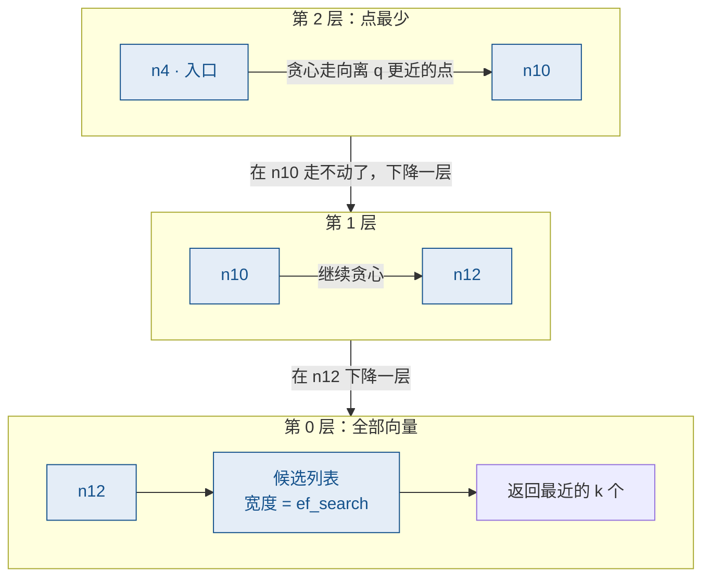

**图 8**　查询从顶层入口出发，每层贪心走向离 q 更近的点，走不动就下降一层；到第 0 层后维护宽度为 `ef_search` 的候选列表。`m` 决定每个点连几条边，`ef_construction` 是建图时的同一个宽度，只影响离线构建。

一项小实例测试中，pgvector 的召回率仅靠调高 `ef_search` 就从约 95% 升到 98%。**在换向量库之前，先确认当前这个的参数已经调过。**

### 4. 增量更新：record manager 模式

开源方案收敛到同一个结构：**一张独立的记录表，存 `source_id` + `content_hash` + `写入时间`**。每次摄入重新计算 hash，未变更的跳过，变更的重写，消失的删除。

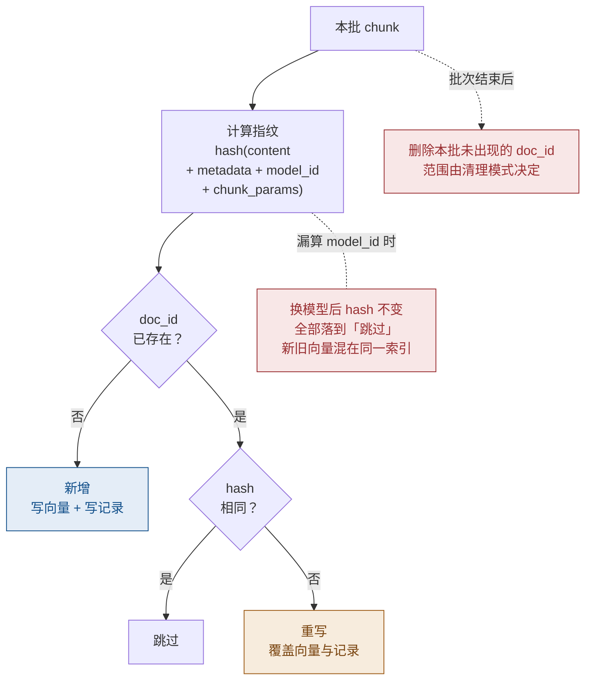

**图 9**　每个 chunk 按指纹三分：新增、跳过、重写；批次结束后再按范围删掉没再出现的。`model_id` 和分块参数必须算进指纹，否则换模型时所有 chunk 都会走进「跳过」，旧向量原封不动地留在索引里。

清理策略有三种语义，必须想清楚再选：

- `incremental` —— 边摄入边清理，适合按来源分批；整源下线发现不了
- `full` —— 全部摄入完再清理。**加载器必须返回全量数据集**，否则会删掉不该删的
- `scoped_full` —— 只清理本次出现过的 `source_id` 范围内的陈旧内容，最安全的默认值；整源下线同样发现不了，需定期跑一次 `full` 对账

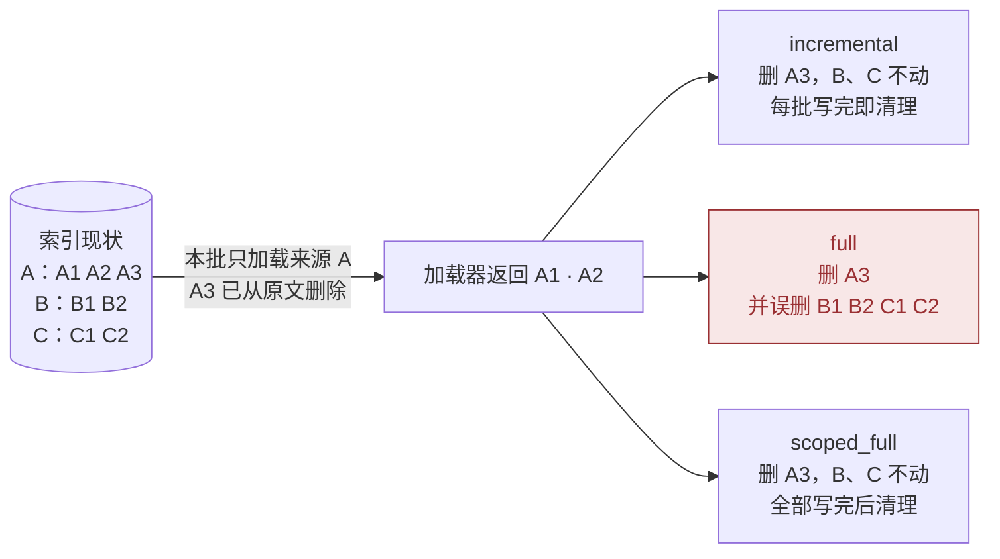

**图 10**　`full` 把「本批没返回」当成「已删除」，所以加载器必须返回全量；另两种只在本批出现过的来源里清理，不会误删，但整源下线（比如来源 C 真的不要了）也发现不了。

两个必须知道的陷阱：

**一致性。** 记录表和向量库是两套存储，记录写成功、向量写失败会留下不一致。要么做补偿重试，要么周期性对账。

**换模型要强制重建。** 更换 embedding 模型后，hash 没变所以增量逻辑会全部跳过，结果是新旧向量混在一个索引里 —— 这种污染很难发现，表现为检索质量无端下降。**把模型标识纳入 hash 计算**，换模型自动触发全量重建。

---

## 四、检索侧

### 1. 混合检索 + RRF

向量召回与 BM25 召回并行，用 **Reciprocal Rank Fusion** 融合，`k = 60`（原论文取值，沿用即可）。RRF 按**排名**而非原始分数融合，因此不需要跨系统归一化分数 —— 这正是它成为默认选择的原因。多个独立评测都显示 RRF 融合在全部指标、全部数据子集上优于任一单路。

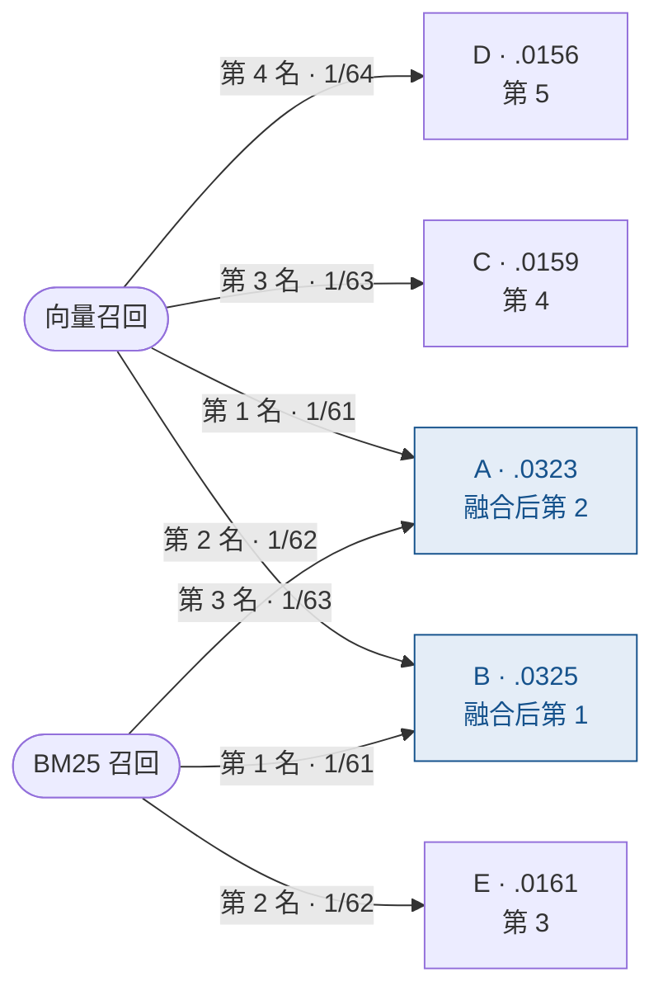

**图 11**　RRF 只看名次：B 在两路分别排第 2 和第 1，总分超过向量路第一的 A；只在一路出现的 E、C、D 排在后面。余弦与 BM25 分不在同一量纲，计算里用不到原始分。

### 2. 重排：单项收益最大的一步

共识很一致：**混合检索打底，加一个 cross-encoder 重排，是单步收益最大的改动**。

典型配置：**召回 50–150 个候选，重排后保留 5–20 个**。Anthropic 的做法是召回 150 重排到 20。

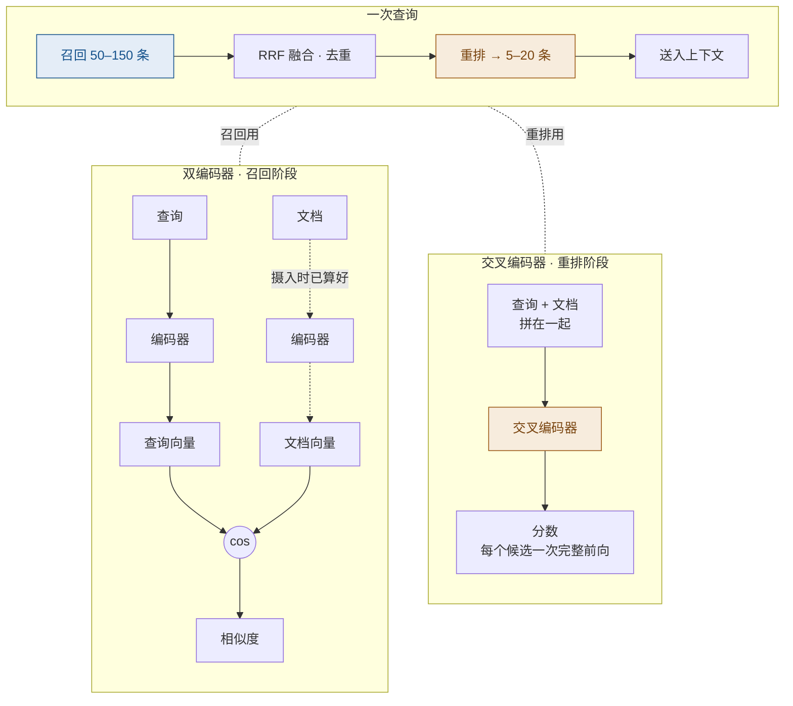

**图 12**　双编码器把查询和文档分开编码，文档侧在摄入时就算好，所以能扫全库；交叉编码器把两者拼在一起过模型，精度更高，但每个候选都要一次前向，只能放在召回收窄之后。

| 模型 | 取舍 |
|---|---|
| **Qwen3-Reranker** | 开源权重质量第一梯队，Apache 2.0 |
| **BGE-reranker-v2-m3** | 下载量与部署量最大，稳妥默认值 |
| **ms-marco-MiniLM 系列** | 延迟最低，质量明显下降，适合强延迟约束 |
| **ColBERT / late-interaction** | 质量好，但多向量使存储与延迟成本增加数倍 |

重排延迟与硬件、批大小、候选数强相关，各处公布的数字差异极大（毫秒级到数百毫秒）。**必须在自己的硬件和候选规模上实测**，不要照搬。

### 3. 查询侧处理

- **查询改写**：把口语化提问转成检索友好的表达；多轮对话必须先做指代消解，否则"它的参数是什么"检索不到任何东西
- **多查询扩展**：一次生成多个同义表达并行检索再去重，对召回的提升稳定且便宜
- **过滤前置**：权限、时间范围、文档类型在检索内部过滤

### 4. 上下文预算是稀缺资源

检索结果**分级返回**：第一级只给标识、摘要、定位；需要细节时第二级再取全文。给 Agent 用的检索工具尤其要这样设计 —— 把完整内容一次性全塞回去，是 Agent 场景里最常见的 context 浪费。

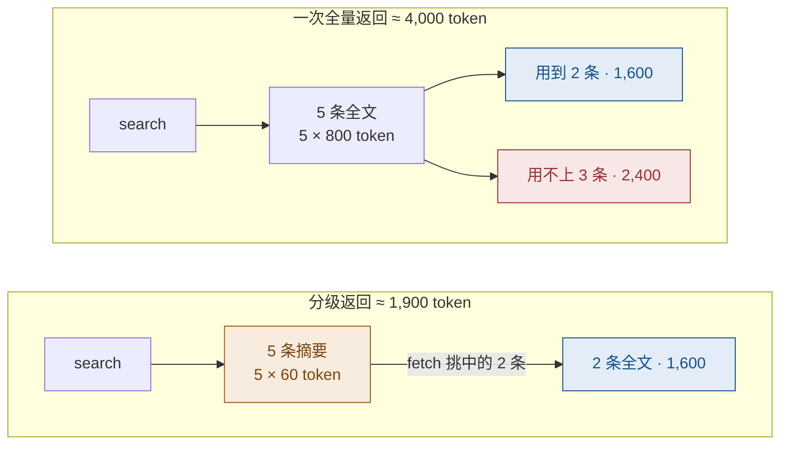

**图 13**　同样拿到需要的 2 条，分级返回少用一半多的上下文。数字为示意：全文约 800 token / 条，摘要约 60 token / 条；差距随命中数与全文长度放大，Agent 多轮调用时还会累积。

---

## 五、图检索：什么时候才需要

GraphRAG 解决的是单一问题：**答案需要跨多个文档聚合关系**（"A 和 B 的关系经历了哪些阶段"、"这个概念在哪些模块间传递"）。普通向量检索对这类问题无能为力，因为答案不存在于任何单个 chunk 里。

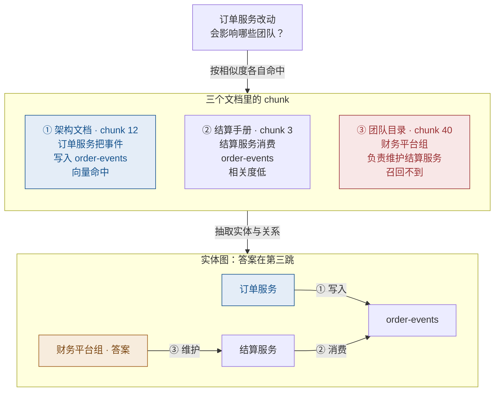

**图 14**　关系型问题的答案不在任何一个 chunk 里：③ 与问题几乎没有共同的词，向量检索召回不到；图把三段里抽出的边连成路径，答案在第三跳。

| 方案 | 取舍 |
|---|---|
| **Microsoft GraphRAG** | 参考实现，MIT；索引阶段大量 LLM 调用，成本高 |
| **LightRAG** | 轻量实现，知识图谱 + 向量检索结合，提供 naive/local/global/hybrid/mix 多种查询模式 |
| **nano-graphrag** | 最小实现，模块化、易定制，适合读懂原理后自己改 |

**判断标准只有一条：你的问题是否需要跨文档关系聚合。** 如果多数问题是定点查找，图索引的建设与维护成本不会回本。先把混合检索 + 重排做扎实，遇到明确的关系型问题再上图。

---

## 六、评测：没有评测等于没有知识库

这是开源实践里最被跳过、也最致命的一环。没有评测就无法判断任何改动是改进还是退步，调优会退化成玄学。

**第一步是建 golden set。** 50–200 条真实问题 + 标注的正确来源，由领域内的人写。规模不重要，代表性才重要。这个集合是所有后续决策的裁判。

**第二步是把检索与生成分开评。** 聚合分数会掩盖问题 —— 检索错了和生成跑偏，看起来都是"答案不对"，但修复方向完全相反。

| 层 | 指标 |
|---|---|
| 检索 | `context precision`、`context recall`、`MRR`、`nDCG@k` |
| 生成 | `faithfulness`（是否忠于检索内容）、`answer relevance` |

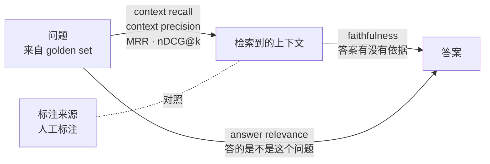

**图 15**　四个指标各量一条边。recall 低就修检索（分块、召回、重排）；recall 高而 faithfulness 低就修生成（prompt、上下文组装）。

工具层面：**RAGAS** 是开源社区最常用的实现，提供上述四类核心指标的 LLM-as-judge 版本；**DeepEval** 偏测试框架形态，易接入 CI；**TruLens** 强在链路追踪与 RAG Triad；**BEIR** 用于检索器本身的横向对比。目前没有单一框架形成统治，按形态选即可。

**第三步是把评测放进 CI。** 分块参数、模型版本、prompt 的每一次改动都跑一次。没有这条回归防线，知识库的质量只会随时间单调下降。

---

## 七、Agentic RAG 与接入层

趋势很清楚：检索正在从"生成前的固定前置步骤"变成"模型可以反复调用的工具"。模型自己决定检索几次、用什么词、要不要换个角度再查一次。

通过 MCP 暴露检索能力时，几条经过验证的工具面设计：

- **接受查询数组而非单个查询**，并行检索后去重。在工具描述里明确要求模型一次给出多个同义表达
- **限制单次返回的条目数**（通常 ≤ 5），防止 context 爆炸
- **详情按需获取**，完整内容默认不返回
- **读写分离**：检索类只读工具与写入类工具彻底分开
- **用工具描述约束模型行为**。把"先检索再回答"写进工具描述，比写在系统提示里有效得多
- **返回结构化失败原因**：「无结果」和「查询太宽泛」要可区分，模型才知道怎么重试

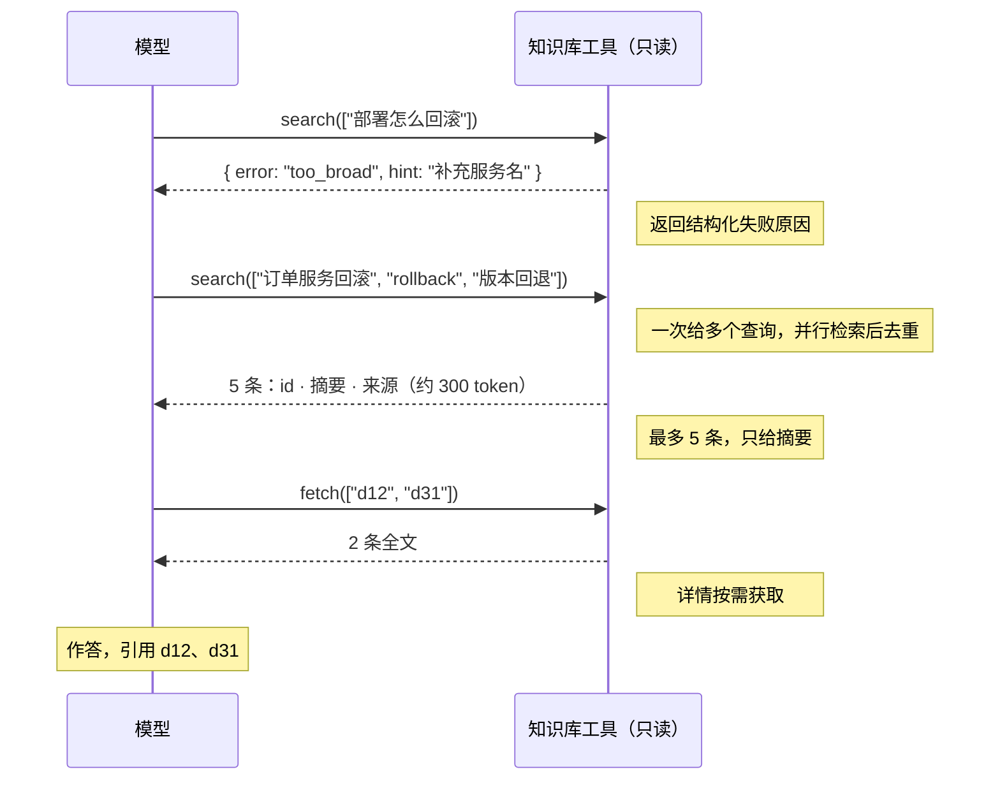

**图 16**　第一次查询太宽泛，工具返回可区分的失败原因；模型据此一次给出多个改写，先拿 5 条摘要，再只取其中 2 条全文作答。

---

## 八、落地顺序

每一步都要能单独产生价值，不能等全套做完才见效。

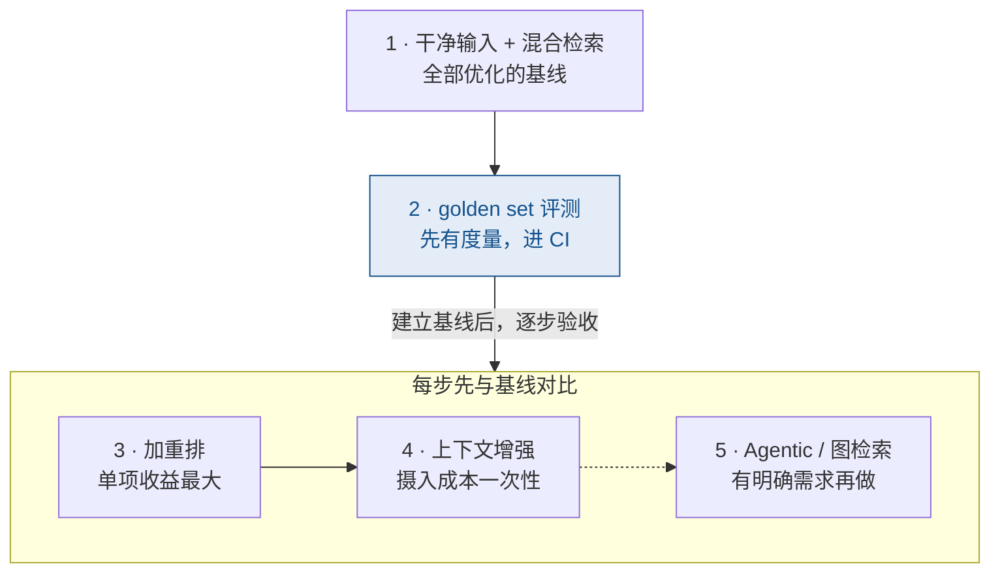

**图 17**　评测是第 2 步，不是最后一步：从第 3 步开始，每项改动都先在 golden set 上与基线比较，赢了才留下；第 5 步用虚线，表示它是有条件的。

**第一步：干净输入 + 结构分块 + 混合检索。**
解析统一成 Markdown，结构感知递归分块，向量 + BM25 双路 RRF 融合。这一步不碰任何花活，是后面所有优化的基线。

**第二步：建 golden set 与评测。**
在加任何新技术之前先建立度量。没有基线数字，后面每一步都无法判断是否有效。

**第三步：加重排。**
单项收益最大，实现成本低。此时应该能在评测上看到明确提升。

**第四步：上下文增强。**
Contextual retrieval 或 late chunking。摄入成本上升，但是一次性的。

**第五步：Agentic 检索与图检索。**
前者看 Agent 场景的实际需求，后者看是否真有跨文档关系型问题。**这两步都不该在前四步做扎实之前开始。**

---

## 九、反模式清单

| 反模式 | 后果 |
|---|---|
| 只做向量检索 | 精确标识符、错误码、专有名词全部检索不到 |
| 脏输入直接分块 | 噪声污染双路索引，后续调优无法补救 |
| 没有评测就调参 | 无法判断改动方向，调优退化成玄学 |
| 权限在应用层后筛 | top-k 被无权内容占满，表现为"有权限却搜不到" |
| 换模型不重建索引 | 新旧向量混杂，质量下降且难以定位 |
| 对原始源码/片段做 embedding | 实现细节淹没意图，相似度失真 |
| chunk 即生成单元 | 要么检索精度差，要么上下文不完整，二选一 |
| 语料很小仍上 RAG | 徒增故障点，效果不如全文入提示词 |
| 查询期做本该摄入期做的事 | 成本乘以 QPS，延迟不可控 |
| 先上 GraphRAG | 建设与维护成本高，多数问题用不上 |

---

## 参考

**核心技术**
- [Introducing Contextual Retrieval — Anthropic](https://www.anthropic.com/news/contextual-retrieval)
- [Reconstructing Context: Evaluating Advanced Chunking Strategies for RAG — arXiv](https://arxiv.org/pdf/2504.19754)
- [From BM25 to Corrective RAG: Benchmarking Retrieval Strategies — arXiv](https://arxiv.org/html/2604.01733v1)
- [RAG Deserves an Index: Why Ingest-Time Compilation Beats Query-Time Interpretation — arXiv](https://arxiv.org/pdf/2608.20845)
- [A Survey of Context Engineering for Large Language Models — arXiv](https://arxiv.org/pdf/2507.13334)
- [When to use Graphs in RAG: A Comprehensive Analysis — arXiv](https://arxiv.org/pdf/2506.05690)

**工程实践**
- [LangChain Indexing API — 记录管理与清理语义](https://python.langchain.com/docs/how_to/indexing)
- [Hybrid Search Explained: BM25 + Vectors + RRF](https://dataaspirant.com/blog/hybrid-search/)
- [RAG Chunking Strategies: The 2026 Benchmark Guide](https://blog.premai.io/rag-chunking-strategies-the-2026-benchmark-guide)
- [Long Context vs RAG: Which to Use in 2026](https://dataaspirant.com/blog/long-context-vs-rag/)

**选型**
- [Qdrant / Weaviate / Milvus / pgvector 同机基准](https://computingforgeeks.com/qdrant-weaviate-milvus-pgvector/)
- [Best Embedding Models for RAG, Ranked by MTEB Score](https://blog.premai.io/best-embedding-models-for-rag-2026-ranked-by-mteb-score-cost-and-self-hosting)
- [Open-source alternatives to Cohere Rerank](https://www.zeroentropy.dev/articles/open-source-alternatives-to-cohere-rerank)
- [Self-host document intelligence: Docling / Marker / MinerU](https://www.spheron.network/blog/self-host-document-intelligence-docling-marker-mineru-rag-guide/)
- [15 Best Open-Source RAG Frameworks](https://www.firecrawl.dev/blog/best-open-source-rag-frameworks)
- [Orama — 浏览器/服务端/边缘的搜索与 RAG 引擎](https://github.com/oramasearch/orama)
- [sqlite-vec — SQLite 向量检索扩展](https://github.com/asg017/sqlite-vec)
- [LightRAG — 轻量 GraphRAG 实现](https://github.com/HKUDS/LightRAG)

**评测**
- [RAGAS](https://github.com/explodinggradients/ragas) · [DeepEval](https://github.com/confident-ai/deepeval) · [TruLens](https://github.com/truera/trulens) · [BEIR](https://github.com/beir-cellar/beir)
